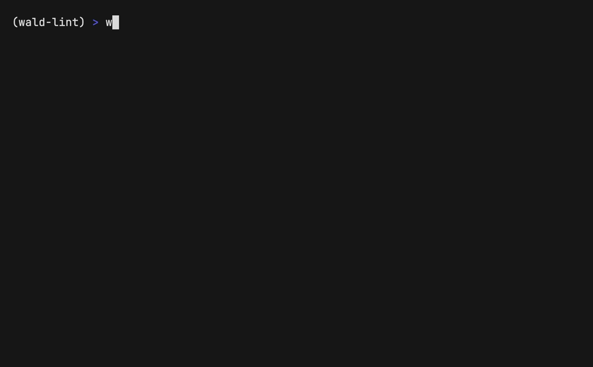

# Wald

**Code linters check style. Wald checks whether the analysis is a lie.**

Wald is a deterministic statistical-integrity linter for Python analysis.
It flags a defined set of methodological hazards in notebooks and scripts,
with evidence, and needs no LLM to do it.

Your model scores 0.99. Wald asks whether the experiment that produced
that number was valid: was the scaler fitted on the test rows, did the
cross-validation shuffle a time series, were twenty tests run with no
correction?



```bash
pip install wald-lint
wald check your_notebook.ipynb
```

A real report, on [`examples/leaky.ipynb`](examples/leaky.ipynb):

```
$ wald check examples/leaky.ipynb

# Wald report — examples/leaky.ipynb

verdict: 1 high, 0 medium | static layer (no LLM)

## HIGH: leakage-fit-before-split
- **Where:** cell 5, line 2
- **Evidence:** `scaler.fit_transform(...)` consumes X, feeding `train_test_split` (cell 5) — the fit happened before the split
- **Flaw:** A transformation (scaler, imputer, encoder, feature selector, PCA, vectorizer) is fitted on data that contains the test set.
- **Failure scenario:** Test metrics are inflated; the production model will underperform the reported numbers.
- **Fix:** Fit the transformer on the training split only; apply transform to the test split.
- **Confidence:** 0.92

## CLEAN (checked): baserate-accuracy-imbalanced, leakage-temporal-shuffle, testing-multiple-uncorrected

```

Exit codes: `0` clean, `1` medium findings, `2` high findings, `3` input
error. Usable as a pre-merge gate.

[`examples/temporal-cv-before-after.ipynb`](examples/temporal-cv-before-after.ipynb)
shows the effect on a metric: the same model scored with shuffled CV and
with `TimeSeriesSplit`, numbers computed in the notebook
(run record: [`evals/`](evals/)).

## Status

| | What |
|---|---|
| **Available now** | `wald check` on `.ipynb` and `.py` (plain and `# %%`); four static flaw classes (below); a survivorship candidate; Markdown, JSON and SARIF output; GitHub Action; pre-commit hooks; `wald rules`; `wald eval --predictions` for scoring other tools on the corpus |
| **Experimental** | `--llm` / `--llm-subscription` narrative layer (prose claims vs computation). No validated precision or recall; its quality gates never ran |
| **Planned** | Generated fixes: a reviewable patch plus a verification recipe for one canonical leakage shape (`wald propose`), then opt-in sandboxed verification. Not shipped |

Tested on Python 3.10 to 3.13 (Linux CI; unit tests also on Windows).

## Rules

| Flaw class | What triggers it |
|---|---|
| `leakage-fit-before-split` | A scaler, imputer, encoder, selector or vectorizer is fitted on data that later feeds `train_test_split` or cross-validation |
| `leakage-temporal-shuffle` | Lag or rolling features on time-ordered data, evaluated with a shuffled split instead of `TimeSeriesSplit` or a time cutoff |
| `testing-multiple-uncorrected` | Many statistical tests with no multiple-comparison correction; reports the implied family-wise error rate |
| `baserate-accuracy-imbalanced` | Accuracy as the only metric while stored outputs show class imbalance |
| `selection-survivorship-cohort` | Candidate only: a filter on a survival-correlated column before aggregation |

`wald rules` prints the full list from `wald/taxonomy/flaws.yaml`.

## Known limitations

- On 60 fresh GitHub notebooks, 25 of 28 flags were real (0.89 precision)
  and Wald caught 12 of 20 leaky notebooks in the audited subset (0.60
  recall). That evidence covers the two leakage classes only
  ([`evals/2026-07-07-dogfood-wide.md`](evals/2026-07-07-dogfood-wide.md)).
- On the 100 labeled notebooks of Yang et al. (ASE'22),
  `leakage-fit-before-split` reached 0.58 precision and 0.37 recall
  against the authors' `pre` label
  ([`evals/2026-10-12-yang-pre.md`](evals/2026-10-12-yang-pre.md)).
- Misses cluster in leaks with no syntactic anchor: per-group imputation,
  `fillna(df[col].mean())` before the split, text vectorizers fitted on
  the full corpus, scalers feeding `cross_val_score`.
- The 0.0% false-positive rate holds on the curated corpus, not on messy
  real code.
- Flaws with no imprint in code, outputs or prose are invisible to Wald.
- Wald never executes your notebook.

Full evaluation, corpus method and dogfood history:
[`docs/EVALUATION.md`](docs/EVALUATION.md).

## How Wald is measured

Detectors are scored by mutation testing: clean notebooks get flaws
injected, and every mutant must mechanically prove the flaw before it
counts. Corpus tables, dogfood runs and detector scope:
[`docs/EVALUATION.md`](docs/EVALUATION.md).

## GitHub Action

`Wake360/wald@v0.3.1` is a composite action that installs `wald-lint`, runs
`wald check` on the paths you pass, writes a SARIF 2.1.0 log, and reports a
`gate-exit-code` mapped through `fail-on` (high, medium, or never). The
action never fails the job itself — it exposes the code and lets your
workflow upload SARIF before gating, so findings show up as inline PR
annotations even on a red run. The consumer must grant `security-events:
write` for the SARIF upload, put Python >= 3.10 on `PATH` (via
`actions/setup-python`), and run on a Linux or macOS runner (the steps are
bash).

```yaml
name: wald
on: [pull_request]

jobs:
  check-notebooks:
    runs-on: ubuntu-latest
    permissions:
      contents: read
      security-events: write
    steps:
      - uses: actions/checkout@v4
        with:
          fetch-depth: 0

      - uses: actions/setup-python@v5
        with:
          python-version: "3.13"

      - name: Find changed notebooks
        id: changed
        run: |
          files=$(git diff --name-only \
            origin/${{ github.base_ref }}...${{ github.sha }} -- '*.ipynb')
          echo "files=$files" >> "$GITHUB_OUTPUT"

      - name: wald
        id: wald
        if: steps.changed.outputs.files != ''
        uses: Wake360/wald@v0.3.1
        with:
          paths: ${{ steps.changed.outputs.files }}
          fail-on: high

      - name: Upload SARIF
        if: always() && steps.changed.outputs.files != ''
        uses: github/codeql-action/upload-sarif@v3
        with:
          sarif_file: ${{ steps.wald.outputs.sarif-file }}

      - name: Gate on wald
        if: steps.changed.outputs.files != ''
        run: exit ${{ steps.wald.outputs.gate-exit-code }}
```

## Pre-commit

`.pre-commit-hooks.yaml` ships two hooks: `wald` for `.ipynb` files,
`wald-scripts` for `.py` files.

```yaml
repos:
  - repo: https://github.com/Wake360/wald
    rev: v0.3.1
    hooks:
      - id: wald
      - id: wald-scripts
```

pre-commit fails the hook on any nonzero exit, so both exit 1 (a medium
finding) and exit 2 (a high finding) block the commit — raise `--floor`
via `args` if you want fewer low-confidence findings to count as
confident. `wald-scripts` runs on every changed `.py` file, so if your
repo has many non-analysis scripts, scope it with `files:`/`exclude:`
in your own pre-commit config.

## Architecture

```
notebook ──> ingest (nbformat) ──> layer A: static detectors ──> report
                                    - libcst def-use dataflow      md / json
                                    - deterministic, key-free      exit code
                                    - exact cell:line + evidence

             layer B (--llm): LLM narrative detector
             claims <-> computation consistency, closed taxonomy,
             span-grounded, verified by a second provider; fuses with
             layer A candidates (filter + population claim = flag)
```

The hybrid split is the point: leakage is an AST pattern — an LLM has no
business there. The LLM layer handles only what statics cannot: whether
the prose claims match what the code computes. Its quality gates (G2/G3)
never ran, so **no narrative-layer numbers are claimed; the static
linter is the validated product.**

The narrative layer runs through the `claude`/`codex` CLIs on
subscription billing: `wald check --llm --llm-subscription <notebook>`.
Its numbers are dev-split and indicative by construction
(`gate_evidence: false`); it has not passed a quality gate. An
indicative dev-split run is at
`evals/2026-07-25-llm-eval-dev-subscription-indicative-rerun.md` —
unpinned models, not reproducible (the prior 2026-07-09 run lost 17/45
files to backend errors; the rerun after hook isolation completed all
files). Static-only is the default; without `--llm`, Wald calls no LLM.

Taxonomy is data (`flaws.yaml`): 9 flaw classes with definition, book
anchor, mutation recipe and severity (`wald rules` lists them). Adding a
class = a record + a detector + a mutation; prompts and reports generate
from the same file, so documentation and detector cannot drift.

## Install & use

```bash
pip install wald-lint
wald check notebook.ipynb            # exit 0 clean / 1 medium / 2 high / 3 input or usage error
wald check analysis.py               # plain script, or percent-format (# %% cell markers)
wald check notebooks/ --keep-going   # continue past unreadable files; exit 3 if any file failed
wald rules                           # list the flaw classes wald checks; --format json for machines
```

Contributing to Wald itself:

```bash
python -m venv .venv && source .venv/bin/activate
pip install -e ".[corpus,dev]"       # or: uv sync --all-extras

wald check examples/leaky.ipynb      # exit 0 clean / 1 medium / 2 high / 3 input or usage error
wald check examples/leaky.ipynb --format json   # one object; a JSON array for multiple notebooks
wald corpus build                    # build clean corpus + verified mutants
wald eval                            # confusion matrix -> evals/<date>-eval.md
pytest                               # unit tests + golden gates G0/G1
```

`examples/leaky.ipynb` ships in the repo and reproduces the report shown
at the top of this file. `examples/leaky.py` is the same analysis as a
percent-format script.

Directory arguments still collect only `*.ipynb`; pass a `.py` file
explicitly. Reported lines for `.py` input are file-absolute (not
relative to the cell); the markdown report keeps `cell N, line M`, where
`N` is the percent-cell's ordinal position in the file.

By default `wald check` aborts on the first unreadable file. `--keep-going`
continues instead: each unreadable file is reported to stderr and the run
still exits 3 if any file failed — even alongside a high-severity finding
elsewhere in the batch, which would otherwise exit 2. The multi-file TTY
summary line gains a `, N failed` suffix.

`wald rules` lists the flaw classes from the taxonomy (id, layer, severity,
definition); `--format json` emits the same data as a JSON array.

Wald never executes *your* notebook (static analysis + stored outputs
only). Only self-authored corpus notebooks are executed, at corpus build
time, to verify mutations.

## Roadmap

- **M2** — LLM narrative layer + cross-provider verifier + fusion: built,
  tested against replay fixtures (`plans/m2.md`), and runs on
  subscription CLIs (`wald check --llm --llm-subscription`). The G2/G3
  gates never ran; narrative numbers stay dev-split and indicative
  (`gate_evidence: false`).
- **M3** — table consistency checks (cohort sums vs. declared population).
- **Benchmark** — the corpus is scoreable by external tools:
  `wald eval --predictions` (`docs/benchmark.md`).
- **M4** — GitHub Action with PR annotations: shipped in 0.2.1
  (`action.yml`). Severity calibration stays parked until flag volume
  exists. (Dogfood on real licensed notebooks: done,
  `evals/2026-07-04-dogfood.md`.)
- Corpus contributions welcome: see `CONTRIBUTING.md` for the clean-corpus
  criteria, real-notebook licensing rules, and the flaw-class contribution
  shape (taxonomy record, detector, mutation with mechanical `verify()`).

## License

MIT.
